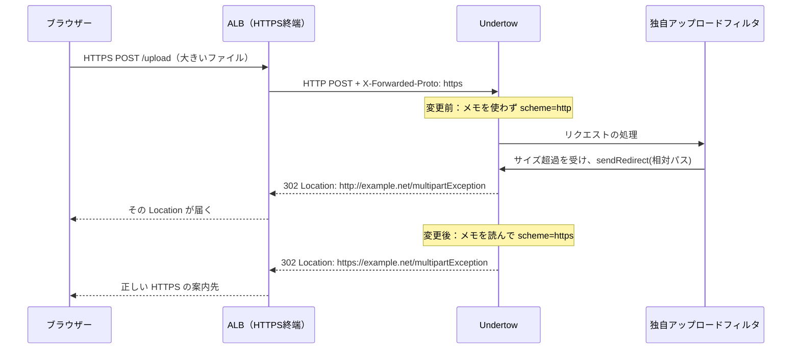

# JBoss EAP 8.1／ALB：アップロードサイズ超過時の HTTPS リダイレクト対応提案

調査日：2026年10月3日（日本時間）／対象：JBoss EAP 8.1、HTTPS 終端は AWS Application Load Balancer（ALB）。

**提案の中心は、ALB が知らせる元の通信方式を、実際にリクエストを受ける Undertow リスナーで認識させることです。ALB → EAP が HTTP の場合、第一候補は `proxy-address-forwarding=true` です。独自フィルタが `http://` を直接指定している場合には、その URL 生成処理も修正します。**

この資料は、ユーザーが確認した現象と、公式資料・公開実装を突き合わせた対応提案です。実環境の設定変更やアップロード試験は実施していません。フィルタのソースコード、ターゲットグループの転送方式、実際のリスナー名は未確認です。以下の例に登場する `example.net`、`/upload`、`/multipartException`、`default-server`、`default`、`/opt/server` は、説明用の値です。

Excel 版は本 Markdown と同じ内容を章ごとに分け、すべてのセルを Meiryo UI、白・黒・グレーの配色にしています。セルの折り返し、行高、列幅、先頭行固定、参照リンク、印刷範囲を設定しています。添付の `scripts/` に CLI・コンテナ起動前設定・Windows での確認用実装を収録しています。

## 01 結論と対応の選び方

### 01.1 まず何をすればよいか

1. ALB のターゲットグループが **HTTP** と **HTTPS** のどちらで EAP に転送しているか確認します。ブラウザー → ALB が HTTPS であることだけでは、EAP 側の受信方式は決まりません。
2. EAP が実際に受信するリスナーを特定し、`proxy-address-forwarding`、公開 Host、転送ヘッダ、フィルタが渡すリダイレクト先を確認します。
3. ALB → EAP が HTTP で、フィルタが通常の相対パスを `sendRedirect` に渡しているなら、該当 **http-listener** に `proxy-address-forwarding=true` を設定します。
4. 有効化するリスナーは信頼する ALB 経由に限定します。公開 Host と、利用者が持ち込む転送ヘッダの扱いも確認します。この属性は scheme 以外の情報にも影響するためです。
5. 設定を実行時に反映し、サイズ超過時の **最初の 302 の生の Location** が `https://公開ホスト/正しいパス` になったことを確認します。

`proxy-address-forwarding` は EAP 8.1 の公式属性です。ALB は、利用者が ALB に接続した方式を `X-Forwarded-Proto` でバックエンドに知らせます。この組み合わせが提案の根拠です。[EAP 8.1 Undertow 設定リファレンス][S01]、[AWS：ALB の転送ヘッダ][S02]

### 01.2 構成・観測値ごとの判断表

| 条件 | 優先する対応 | Undertow の対象 | 完了の確認 |
| --- | --- | --- | --- |
| ALB → EAP は HTTP、アプリ認識は http、相対パスで sendRedirect | 転送ヘッダの信頼条件を整え、proxy-address-forwarding=true | 実際の http-listener | scheme=https、isSecure=true、Location=https |
| ALB → EAP は HTTP、ヘッダに X-Forwarded-Proto がない／http | ALB 直後から EAP までの経路を確認し、元の方式を正しく伝える | 属性だけを変えても不足 | EAP に https が届いてから再試験 |
| アプリ認識は https、フィルタの引数が http の絶対 URL | フィルタの設定値・URL 生成・レスポンスラッパーを修正 | 設定追加だけでは直らない | フィルタの引数と最初の Location を比較 |
| ALB → EAP は HTTPS | https-listener と公開 Host／port を確認。必要なら同属性を設定 | 実際の https-listener | 公開 URL と EAP の生成 URL が一致 |
| EAP 応答は https、ブラウザー側では http | 中継のレスポンス書き換えを確認 | EAP だけの変更を先行しない | 同一リクエストの両地点で Location を比較 |
| 実際に HTTP でアクセスした利用者を HTTPS に移す | ALB の HTTP リスナーで HTTPS へ redirect | ALB の別機能 | HTTP → HTTPS の入口動作を確認 |

この表は本件についての設計判断です。ALB → HTTP → EAP が最も説明しやすい仮説ですが、ターゲットグループとフィルタの実装を確認するまでは根本原因の確定ではありません。

### 01.3 今回、必ず区別する三つの設定

| 項目 | やさしい説明 | 実際の役割 | 今回の優先度 |
| --- | --- | --- | --- |
| proxy-address-forwarding | 校門の先生から来た「元の道」のメモを読む | X-Forwarded-* から scheme、Host、送信元等を認識 | HTTP バックエンドなら第一候補 |
| redirect-socket | 安全な入口に案内するときの「入口番号」を決める | SSL が必要な資源へのコンテナ側リダイレクトのポート | CONFIDENTIAL 等がある場合だけ追加検討 |
| secure | この入口から来た人を安全扱いにする | HTTPS でなくても secure として扱う属性 | URL の方式修正の代替としては選ばない |

`redirect-socket` を 443 に変えれば、あらゆる `sendRedirect` の HTTP が HTTPS に変わる、という理解は誤りです。`secure=true` も暗号化を追加する設定ではありません。[EAP 8.1 Undertow 設定リファレンス][S01]、[Undertow：リダイレクト実装][S04]、[Undertow：リクエスト情報の実装][S05]

## 02 確認済みの事実と未確認事項

### 02.1 ユーザーが確認したこと

| 区分 | 内容 | この事実から分かること |
| --- | --- | --- |
| 製品 | JBoss EAP 8.1 | EAP 8.1 の Undertow 管理属性で検討する |
| HTTPS 終端 | AWS ALB | EAP 本体がブラウザーとの TLS を直接処理するとは限らない |
| 発生条件 | アップロードのファイルサイズ超過 | 大きいリクエストを読む経路でエラー処理が動く |
| 例外 | RequestTooBigException | 少なくともサイズ制限に関係する例外が発生している |
| アプリ処理 | IBOWildflyUploadErrorFilter が動作 | 独自フィルタのエラー応答処理に到達している |
| 応答 | HTTP 302、Location に http://…/multipartException | 公開 HTTPS URL に対して、案内先が HTTP になっている |

依頼文には「multiException」と「multipartException」の両方が登場します。本資料の例は Location の記載に合わせて `/multipartException` としますが、実装前には `web.xml`、アノテーション、フレームワークのルーティングで正しい名前を確認します。誤ったページへ移す設定変更はしません。

### 02.2 まだ確認できていないこと

| 未確認事項 | 必要な理由 | 確認方法 |
| --- | --- | --- |
| ALB ターゲットグループの Protocol／Port | EAP が HTTP と HTTPS のどちらで受けるかが決まる | AWS コンソール／describe-target-groups |
| Undertow server／listener／socket-binding の実名 | 別のリスナーを変えても本件に反映されない | CLI の read-children-names と read-resource |
| フィルタの URL 生成方法 | 相対パスの絶対化と、HTTP の直接指定で対処が異なる | sendRedirect、Location、http:// 等を検索 |
| ALB と EAP の間の中継 | scheme・Host のメモを書き換える可能性がある | ECS/EKS の構成、Ingress、sidecar、プロキシ設定 |
| 外側と内側のパス変換 | contextPath と公開パスが一致するとは限らない | ALB のルール transforms とアプリの配備設定 |
| EAP 8.1 の Update 番号 | Red Hat の修正を含む実装を特定する | product-version、導入履歴、適用済み更新 |
| multipart の上限と listener の上限 | どの層で拒否したかを判断する | max-post-size、max-file-size、max-request-size 等 |

### 02.3 本資料での仮説

最有力は「ALB が HTTPS を終端し、HTTP で EAP に渡す。Undertow の転送ヘッダ処理が無効なので scheme が http のまま。フィルタの相対 `sendRedirect` が HTTP の絶対 URL になる」という経路です。もう一つは「フィルタが `http://` を直接組み立てる／固定する」という経路です。さらに、レスポンスラッパーや中継で書き換わる経路もあります。

ここでは、一般論から一つに決めつけず、フィルタ直前の認識値・引数・EAP の生の応答を使って区別します。

## 03 小学生にも分かる動作原理と通信図

### 03.1 校門の先生と教室の先生で考える

ブラウザーを「生徒」、ALB を「校門の先生」、EAP を「教室の先生」、Undertow を「教室前の受付」、独自フィルタを「荷物を調べる係」にたとえます。

生徒は鍵のかかった道、つまり HTTPS で校門に来ました。校門の先生は鍵を開け、校内の別の道、つまり HTTP で教室へ連絡します。受付が校内の道だけを見ると「この生徒は HTTP で来た」と思ってしまいます。

そこで校門の先生が「この生徒が校門まで使ったのは HTTPS です」というメモを付けます。そのメモが `X-Forwarded-Proto: https` です。`proxy-address-forwarding=true` は、受付がこのメモを読んで、元の道を正しく理解する設定です。

荷物が大きすぎると係が別の部屋へ案内します。その案内札が HTTP 302 の `Location` です。受付の記録が間違っていると、案内札の道も HTTP になります。係の手元に HTTP と書いた札が最初から用意されている場合は、その札自体も直す必要があります。

メモを読むだけで校内の HTTP が暗号化されるわけではありません。ALB → EAP も暗号化する要件がある場合は、HTTPS ターゲットグループ、EAP の HTTPS リスナー、証明書等を別途設計します。アプリが返す公開 URL の方式と、内側の実際の暗号化は別の情報です。

### 03.2 変更前と変更後




この図は、ALB → EAP が HTTP で、フィルタが通常の相対パスを使う場合の説明です。フィルタの具体的な捕捉方法や例外のラップ構造は実装によって異なります。

### 03.3 URL は四つの部品でできる

| 部品 | 例 | 説明 | 間違えるとどうなるか |
| --- | --- | --- | --- |
| scheme | https | HTTP か HTTPS かという通信方式 | HTTP への案内になる |
| host | example.net | 公開する住所 | 内部名や意図しないドメインへ移る |
| port | 443 | 入口番号。HTTPS の標準なら表示を省略できる | :8080 や :8443 など外部から届かない入口になる |
| path | /app/multipartException | 建物の中の部屋 | 404、別アプリ、リダイレクトループになる |

このため「https が付いた」だけでは完了しません。公開 host・port・context path も確認します。`https://example.net:443/...` も HTTPS の URL として正しいものですが、標準ポートを省略した形が一般的です。

### 03.4 sendRedirect が HTTP を作る流れ

Undertow の公開実装では、`sendRedirect` に絶対 URL を渡した場合、その URL を Location に設定します。相対パスの場合は、リクエストの scheme と Host／port を使って絶対 URL を作ります。理解のための式は次のとおりです。実コードの転載ではなく、動作を説明する疑似式です。

```text
相対パスの場合の Location
  = Undertow が認識する scheme
    + "://"
    + 公開 host と必要な port
    + 解決された path

変更前の例：http  + "://" + example.net + /multipartException
変更後の例：https + "://" + example.net + /multipartException

引数が http://example.net/... という絶対 URL の場合：
  その引数を設定するので、scheme の認識だけ直しても引数は直らない。
```

`sendRedirect("/multipartException")` に変更するだけで、Location が必ず相対値のまま残るわけではありません。Servlet API と Undertow の絶対化処理を踏まえる必要があります。[Jakarta Servlet 6.0：sendRedirect][S06]、[Undertow：リダイレクト実装][S04]

### 03.5 RequestTooBigException は何を意味するか

`RequestTooBigException` は「読もうとしたリクエストが許可された大きさを超えた」ことに関係する例外です。ファイル一つの上限、multipart 全体の上限、HTTP リスナーの POST 上限は同じではありません。multipart 全体にはファイルに加えて境界文字や通常のフォーム項目も含まれます。

サイズ超過はエラー処理を呼び出すきっかけです。「サイズ超過だから HTTPS が HTTP に変わる」という仕様ではありません。今回の推論では、普段は通らないリダイレクト経路が動くことで、既存の scheme 認識や URL 生成の問題が見えるようになっています。

アップロード制限を大きくして例外を出なくする対処は、今回の URL の問題を解決しません。サイズ制限は元の業務・資源保護要件に合わせて維持し、案内先の生成を直します。

## 04 登場の歴史・背景と、なぜ必要になったのか

### 04.1 一台で受けていた時代から、入口を分担する時代へ

昔の単純な構成では、利用者が接続するサーバー自身が HTTPS を処理すれば、サーバーは TLS 接続から直接 HTTPS と分かりました。利用者が増えると、一台の入口で複数のアプリへ振り分ける、証明書をまとめて管理する、障害のあるサーバーを外す、といった分担が便利になります。

このとき、入口が TLS を終端し、その後を別の HTTP 接続にすると、アプリは「最後の区間」を見るようになります。元の方式・住所・利用者の情報がそのままでは失われるため、転送ヘッダが必要になります。これは今回の構成から説明できる背景です。

### 04.2 年表

| 時期 | 出来事 | 本件とのつながり | 出典 |
| --- | --- | --- | --- |
| 1999年 | 旧 HTTP/1.1 仕様 RFC 2616 では Location の絶対 URI を規定 | サーバーが scheme を含む案内先を作る設計の背景 | S28 |
| 2014年6月 | RFC 7239 が Forwarded ヘッダを標準化 | プロキシで失われる情報を伝える必要性が仕様として整理された | S18 |
| 2014年6月 | RFC 7231 で Location の URI-reference を規定 | HTTP の相対 Location と Servlet API の絶対化を区別する必要がある | S29 |
| 2016年6月 | JBoss EAP 7 が登場。Web 層は JBoss Web から Undertow へ | EAP 6 時代の設定名をそのまま使えない理由 | S20／S21 |
| 2016年8月 | AWS が Application Load Balancer を発表 | HTTP の内容を見てアプリへ振り分ける入口が普及 | S22 |
| EAP 8 系 | Jakarta EE 10／Servlet 6.0 を採用 | 独自フィルタを変更する場合は jakarta.servlet の API を使う | S23 |
| 2026年10月の確認 | EAP 8.1 の公開一覧に Update 7.1 が掲載 | 古い EAP 設定例だけで判断せず、8.1 と導入済み Update を確認する | S24／S25 |

年表は登場の順序を説明するもので、今回の事象が特定の Update の不具合であるという意味ではありません。[RFC 7239][S18]、[RFC 7231][S29]、[EAP 7 移行ガイド][S20]、[EAP 7 発表][S21]、[ALB 発表][S22]、[EAP 8 の標準 API][S23]

### 04.3 X-Forwarded-* と Forwarded は同じ名前ではない

`X-Forwarded-Proto`、`X-Forwarded-For` 等は広く使われてきたヘッダです。RFC 7239 の標準ヘッダ `Forwarded` は、例えば `proto=https` や `host=...` を一つの体系で表します。

ただし「標準だから `Forwarded` を付ければ今回の属性が必ず読む」という置き換えはできません。本件では ALB が提供する `X-Forwarded-*` と EAP の `proxy-address-forwarding` の対応を使います。Undertow には別の Forwarded 処理もありますが、本件の最小対応として新しいハンドラを追加する必要は確認できていません。[RFC 7239][S18]、[AWS：ALB の転送ヘッダ][S02]、[Undertow：転送ヘッダ処理][S03]

### 04.4 最新情報の扱い

2026年10月3日の閲覧では、EAP 8.1 の公式ドキュメント一覧に Update 7.1 が掲載され、該当記事の公開部分に 2026年8月21日の更新日時が表示されました。記事本文は契約者向けで、修正一覧は未確認です。本資料は、その Update が本件を修正するとは主張しません。導入済み Update の確認と、必要な更新の判断は別途行います。[EAP 8.1 ドキュメント一覧][S24]、[Update 7.1 の公開ページ][S25]

現在の ALB はリスナールールで Host と URL パスの書き換えも提供します。そのため「ALB は必ず Host と path をそのまま渡す」という古い前提も置きません。利用中のルール transforms を確認します。[AWS：リスナールール transforms][S14]

## 05 原因を確定する調査手順

### 05.1 観測する場所をそろえる

一回のサイズ超過アップロードについて、時刻または既存のリクエスト ID を使い、ブラウザー／ALB／EAP／フィルタの情報を対応させます。認証トークン、Cookie の値、アップロード本文、個人情報を資料や一般ログに記録する必要はありません。

ブラウザーの Network ではログを保持し、最初の POST のステータスと Response Headers を確認します。後続の GET やブラウザーの最終表示 URL だけを見ないことがポイントです。HSTS や ALB の HTTP → HTTPS 案内で最後には HTTPS に戻っていても、最初の Location が HTTP なら生成側は未修正です。

### 05.2 EAP の認識値

| 読む情報 | 変更前の想定例 | 変更後の期待例 | 判断の意味 |
| --- | --- | --- | --- |
| request.getScheme() | http | https | アプリに見える方式 |
| request.isSecure() | false | true | 元の HTTPS が認識されたか |
| request.getServerName() | example.net | example.net | 公開 Host の保持 |
| request.getServerPort() | 80 または Host 等に応じた値 | 443（公開が443の場合） | 公開側のポート認識 |
| request.getLocalPort() | 8080 等 | 8080 等でも正常 | 内側で待ち受けるポート。443になる必要はない |
| request.getProtocol() | HTTP/1.1 等 | HTTP/1.1 等でも正常 | HTTP のバージョンであり、https の判定値ではない |
| EAP に届く X-Forwarded-Proto | https | https | ALB のメモが届いているか |
| フィルタの sendRedirect 引数 | 相対パスか http の絶対 URL | 正しい相対パスか承認したhttps URL | どこで URL が決まるか |

この表の値は例です。`getServerPort()` と `getLocalPort()` の役割を混同しないようにします。実装上、通常の Host にポートがなく scheme が https なら公開側は 443 と解釈されます。[Undertow：リクエスト情報の実装][S05]

### 05.3 ソースコードで検索すること

次はアプリのソースがあるディレクトリで実施する検索例です。本作業フォルダーにはフィルタの実装がないため、この検索で原因を確定したとは報告していません。

```powershell
rg -n 'IBOWildflyUploadErrorFilter|multipartException|multiException' .
rg -n 'sendRedirect|setHeader|Location|http://|getScheme|getRequestURL|getServerPort' .
rg -n 'max-file-size|max-request-size|MultipartConfig|RequestTooBigException' .
```

見る順序は、フィルタの捕捉処理 → 渡している URL → URL の設定元・組み立て元 → 応答ラッパー → フィルタ順序 → エラー画面のマッピングです。フィルタの名前からフレームワークやコード内容を推測しません。

### 05.4 分岐して原因を絞る

| 調査結果 | 支持される原因 | 次の確認 |
| --- | --- | --- |
| EAP に X-Forwarded-Proto=https、scheme=http | Undertow がメモを使っていない／受信リスナーを誤認 | 実際の proxy-address-forwarding と listener 名 |
| メモ自体がない／http | 中継で削除・再設定、別経路、ALB の入口がHTTP | ALB のターゲットと中継経路を一段ずつ確認 |
| scheme=https、引数=http://… | アプリ側で HTTP を固定・再構成 | 固定設定、URL ビルダー、レスポンスラッパー |
| 引数は相対、EAP の生 Location がhttp | exchange と wrapper の不一致、別の応答処理等 | 実際の Undertow 実装・レスポンス生成地点 |
| EAP はhttps、ALB経由の生応答はhttp | 中継の応答書き換え | 同一リクエストのレスポンス経路 |
| 設定値はtrue、schemeはhttpのまま | 反映前、別リスナー、ヘッダ異常、別Pod | server-state、各ターゲット、リクエスト到達先 |

### 05.5 ALB のログで補助確認する

ALB のアクセスログがすでに有効なら、`elb_status_code`、`target_status_code`、`actions_executed` 等を使います。ターゲット側が 302 を返したのか、ALB 自身の redirect action なのかを区別できます。ただし通常の ALB アクセスログで、任意のレスポンス Location まで直接確認できるわけではありません。生のヘッダの確認を置き換えないでください。[AWS：ALB アクセスログ][S13]

## 06 ALB 側の確認事項

### 06.1 まず確認する設定

| 設定／情報 | 本件で見る値 | 何のためか |
| --- | --- | --- |
| 公開リスナー | HTTPS、通常443 | 利用者との TLS を終端する場所 |
| ターゲットグループ Protocol／Port | HTTP:8080 等、または HTTPS:8443 等 | 変更すべき EAP リスナーを選ぶ |
| X-Forwarded-Proto | HTTPS 公開要求なら https | 元の方式の情報 |
| X-Forwarded-Port | 公開が443なら443 | 元の公開側のポート情報 |
| Host | 公開ホストが EAP に届くか | 絶対 URL の住所に使われる |
| ルールの transforms | host-header-rewrite、url-rewrite の有無 | 公開住所・path が変更されていないか |
| XFF 処理モード | append／preserve／remove | remoteAddr の認識への影響 |
| ターゲットの接続元制限 | ALB の SG からのみ、対応する実ポート | 信頼してよい経路を限定する |

ALB の `X-Forwarded-Proto` と `X-Forwarded-Port` は、外側の方式・ポートを表します。ALB が通常提供する X-Forwarded 系として公式ページに挙がるのは For、Proto、Port です。`X-Forwarded-Host` が ALB によって安全に作り直されるという前提は置きません。[AWS：ALB の転送ヘッダ][S02]

### 06.2 Host を保つ設定は、必要性を確認して使う

通常の HTTPS:443、Host=example.net、Host 書き換えなしなら、Host の既定の扱いでも公開ホスト名が届く構成があります。`routing.http.preserve_host_header.enabled=true` は、本件の scheme 修正に常に必須ではありません。

公開ポートが非標準、利用者指定の Host のポートを厳密に保つ必要がある等の場合は、現在の値とアプリの仮想ホスト要件を見て検討します。保存を有効にしても Host 自体の正当性が検証されるわけではありません。[AWS：Host ヘッダ保持][S10]

読み取り用 AWS CLI の例です。ARN とリージョンは承認された実環境の値を使い、出力にはアカウントや内部構成の情報が含まれることに注意します。以下のコマンドを本作業では実行していません。

```powershell
$AlbArn = '実環境のALB ARN'
$TargetGroupArn = '実環境のターゲットグループ ARN'
$ListenerArn = '実環境のHTTPSリスナー ARN'
aws elbv2 describe-load-balancer-attributes --load-balancer-arn $AlbArn
aws elbv2 describe-target-groups --target-group-arns $TargetGroupArn
aws elbv2 describe-rules --listener-arn $ListenerArn
```

### 06.3 転送ヘッダを信頼するための具体的な条件

**接続元を ALB に限定することと、利用者が持ち込んだヘッダを信頼しないことを、両方確認します。** ALB の SG を接続元にしても、利用者が ALB を経由して送った任意ヘッダまで安全になるわけではありません。

| 対象 | 推奨する扱い | 理由 |
| --- | --- | --- |
| EAP の受信ポート | 実際に EAP に到達する SG／Pod の経路を ALB からに限定 | EAP 直アクセスで転送ヘッダを偽造させない |
| 公開 Host | 許可する公開ホストを入口／アプリで確認 | 不正な Host から外部サイトの Location を作らせない |
| 利用者指定 X-Forwarded-Host | ALB 直前の WAF 等で拒否、または信頼する中継で除去・再設定 | Undertow が Host として使うため |
| 利用者指定 X-Forwarded-For | ALB 直接公開なら持ち込みを拒否する案等を検討 | append で残る先頭の偽IPを信用しないため |
| CDN 等の多段構成 | 信頼する中継ごとの設定とヘッダ順序を確認 | 正当な既存ヘッダまで拒否しないため |

AWS はターゲットの SG で、ALB の SG を接続元にする方法を示しています。EKS の target-type=instance なら NodePort 等、target-type=ip や ECS の awsvpc なら Pod／Task の経路に合わせます。全環境で「8080の SG 一つ」だけを変えると決めつけないでください。[AWS：ALB とターゲットの SG][S11]

### 06.4 X-Forwarded-For の落とし穴

ALB の既定は XFF の `append` です。持ち込まれた値があると、その後ろに ALB が確認した接続元を追加します。一方、参照した Undertow の ProxyPeerAddressHandler はカンマ区切りの先頭値を使います。この二つを組み合わせると、先頭にある利用者指定の偽IPが remoteAddr に使われる可能性があります。

これは「HTTPS の方式修正」と同時に、同じ属性が送信元認識にも影響するために必要な検討です。remoteAddr をアクセス制御や監査で利用している場合は特に確認します。実際の Red Hat 同梱版も確認してください。[AWS：ALB の XFF モード][S02]、[Undertow：転送ヘッダ処理][S03]

ALB 直公開で先行プロキシがない場合の WAF 設計例は、`SingleHeader` の `x-forwarded-host` と `x-forwarded-for` に非空の持ち込みがあれば Block するルールです。`SizeConstraintStatement` の GT／Size=0、TextTransformation=NONE 等を組み合わせられます。ルールの優先順位、重複ヘッダ、許容する正当な通信を試験してから反映します。これは設計例で、既存 Web ACL を置き換える完成設定ではありません。[AWS WAF：単一ヘッダ][S16]、[AWS WAF：サイズ条件][S17]

XFF を `remove` にすれば元の利用者IPを失います。`preserve` に変えるだけでは利用者の値をそのまま残すため、偽装対策になりません。ALB 前段に CloudFront 等がある場合は、信頼経路を個別に設計します。

### 06.5 ALB の新しいヘッダ機能との違い

現在の ALB には mTLS／TLS ヘッダの名前変更、特定レスポンスヘッダの追加等があります。ただし、これを「どんなリクエストヘッダでも任意に削除・書き換えられる」機能と解釈しません。`X-Forwarded-Host` の除去を、根拠なくその機能だけで実装できるとは案内しません。[AWS：ALB ヘッダ変更][S15]

HTTP の利用者を HTTPS へ移す ALB redirect action も、本件のアプリが作った誤った Location を生成元で修正する設定とは別です。入口で HTTPS に戻せても、一度 HTTP を案内したという事実は残ります。[AWS：ALB リスナーアクション][S12]

## 07 Undertow の設定と反映原理

### 07.1 HTTP ターゲットグループでの基本設定

次は `default-server` の `default` という HTTP リスナーを、ALB が利用している場合の基本命令です。実名を調べてから置き換えます。

```cli
/subsystem=undertow/server=default-server/http-listener=default:write-attribute(name=proxy-address-forwarding,value=true)
```

この設定は、EAP 全体のすべての HTTP 入口を無差別に変更するものではなく、指定したリスナーに適用します。ALB が使わない別のリスナーだけを変えても本件は直りません。

有効化すると、Undertow はアプリの Servlet フィルタより手前で転送ヘッダを解釈します。元の方式が https なら exchange の scheme に反映され、アプリのリクエスト認識と、通常の相対 `sendRedirect` の組み立てに使われます。[EAP 8.1 Undertow 設定リファレンス][S01]、[Undertow：転送ヘッダ処理][S03]、[Undertow：リダイレクト実装][S04]

### 07.2 ヘッダと情報の対応

| 情報 | 主な入力 | 本件での期待 | 注意点 |
| --- | --- | --- | --- |
| 元の scheme | X-Forwarded-Proto | https | ヘッダがない場合、設定だけで元の方式は作れない |
| 公開 Host | 通常の Host、または X-Forwarded-Host | example.net | ALBでX-Forwarded-Hostが生成される前提は不要 |
| 公開 port | Host の port、scheme の標準値、処理される転送情報 | 443 | X-Forwarded-Portだけを常に独立反映するとは限らない |
| remoteAddr | X-Forwarded-For | 信頼できる利用者IP | ALB append と先頭値の関係を確認する |
| 内側の local port | EAP の受信ソケット | 8080等のままでよい | 公開portと一致させる必要はない |

参照した公開実装では、X-Forwarded-Port の Host への反映は X-Forwarded-Host を処理する分岐にあります。通常の公開443では、Host にポートがなく、scheme が https に直れば443と認識できるため、X-Forwarded-Hostを追加する必要はありません。公開が非標準ポートの場合は、EAPに届く Host の port と実際の認識値を確認します。[Undertow：転送ヘッダ処理][S03]、[Undertow：リクエスト情報の実装][S05]

### 07.3 HTTPS ターゲットグループの場合

ALB → EAP を HTTPS にしているなら、変更対象は `https-listener` です。すでに HTTPS と認識される場合でも、公開 Host／port や前段の方式と区別する必要があれば転送情報を使用します。外側が常に HTTPS かどうかも確認します。

```cli
/subsystem=undertow/server=default-server/https-listener=https:write-attribute(name=proxy-address-forwarding,value=true)
```

EAP 8.1 のリファレンスには HTTPS リスナーの同属性も記載されています。古い EAP の記事だけを根拠に「HTTPS リスナーには設定できない」とは判断しません。[EAP 8.1 Undertow 設定リファレンス][S01]

### 07.4 設定値の保存と実行時の反映

管理 CLI による変更は構成に保存されます。ただし「保存された値が true」と「今、処理中の受信リスナーに反映されている」は別の確認です。実機で `read-resource-description` の restart-required、変更結果の response-headers、`server-state` を見ます。

```cli
/subsystem=undertow/server=default-server/http-listener=default:read-resource-description
:read-attribute(name=server-state)
```

`reload-required` が表示された場合は、対象を切り離したうえで reload して反映します。以下の手順は、対象一台を drain → 設定 → reload → healthy と実動作を確認 → 復帰、という運用を前提にしています。実機がサービス再起動で反映済みと明示している場合も、最後の実動作確認は行います。[EAP 8.1：管理方式と構成保存][S07]、[管理 CLI 共通ガイド][S08]

### 07.5 XML で見るとどうなるか

これは対応関係を見るための要素の抜粋です。既存の namespace、他の属性、セキュリティ設定をコピーで置き換えないでください。起動中は CLI を使用します。

```xml
<http-listener name="default"
               socket-binding="http"
               proxy-address-forwarding="true" />
```

すでに `redirect-socket` や `enable-http2` 等がある場合はその構成に属性が追加されるイメージです。CLI を使う理由は、EAP が管理モデルに従って保存し、実行中の XML との食い違いを避けられるためです。[EAP 8.1：管理方式と構成保存][S07]

### 07.6 設定しないもの・役割を混同しないもの

| 項目 | 本件での扱い | 理由 |
| --- | --- | --- |
| proxy-protocol=true | ALB の通常 HTTP 転送には設定しない | X-Forwarded-* と異なる接続プロトコルで、双方の対応が必要 |
| certificate-forwarding=true | 本件の URL 修正のために有効化しない | クライアント証明書情報の転送に関係する別用途 |
| secure=true だけ | scheme 修正の第一候補にしない | secure 扱いと scheme の変更は別で、暗号化も追加しない |
| scheme=https を http-listener に書く | AJP等の別リスナーの例を流用しない | http-listener の実機の管理モデルにない属性は設定できない |
| max-post-size の引き上げ | 本件の修正として行わない | エラー経路を避けるだけで HTTP Location は直らない |

公開実装の `isSecure()` は scheme が https の場合や secure の印を見ます。一方、相対 `sendRedirect` の URL は scheme を使います。そのため secure の印だけを変更しても同じ修正結果とは限りません。[EAP 8.1 Undertow 設定リファレンス][S01]、[Undertow：リクエスト情報の実装][S05]、[Undertow：リダイレクト実装][S04]

## 08 起動中のコンテナで jboss-cli により設定する

### 08.1 実行する場所を区別する

| 場所 | 使用する構文 | 例 | 用途 |
| --- | --- | --- | --- |
| Windows の作業端末 | PowerShell | docker cp、docker exec | コンテナへファイルを渡す／入る |
| Linux コンテナ内 | sh と Linux パス | "$JBOSS_HOME/bin/jboss-cli.sh" | EAP の CLI を起動する |
| jboss-cli の対話画面／.cli | EAP 管理 CLI | /subsystem=undertow/...:write-attribute | 管理モデルを操作する |

以下は Docker を使用する **Linux コンテナ** の例です。コンテナ名は `eap-container` と仮置きしています。ECS Exec、kubectl exec、oc rsh で入る環境でも、コンテナ内の CLI 命令は同じです。Windows の PowerShell に CLI の `/subsystem=...` を直接入力するのではありません。

### 08.2 手順1：コンテナに入り EAP の場所を確認

Windows／PowerShell：

```powershell
docker exec -it eap-container /bin/sh
```

ここからは **Linux コンテナ内**：

```sh
printf '%s\n' "$JBOSS_HOME"
test -x "$JBOSS_HOME/bin/jboss-cli.sh"
"$JBOSS_HOME/bin/jboss-cli.sh" --connect --controller=127.0.0.1:9990
```

`JBOSS_HOME` が空なら、コンテナの起動設定・イメージの文書で実際のディレクトリを確認し、設定します。`/opt/server` は EAP のコンテナ資料で使われる例ですが、実環境の場所を確認せず決め打ちしません。管理ポートが変更されていれば9990も置き換えます。

同じコンテナ内で実行することで、既定の local authentication が使える場合があります。権限不足の場合はコンテナの実行ユーザーと管理認証を確認します。管理ポートをインターネットに公開したり、パスワードをスクリプトに埋め込む対応は不要です。[EAP 8.1：管理 CLI と local authentication][S07]

### 08.3 手順2：実際の名前を調べる

ここからは **jboss-cli**：

```cli
:read-attribute(name=product-name)
:read-attribute(name=product-version)
:read-attribute(name=launch-type)
:read-attribute(name=server-state)
/core-service=server-environment:read-attribute(name=config-file)
/subsystem=undertow:read-children-names(child-type=server)
:read-children-names(child-type=socket-binding-group)
```

`00_discover.cli` に収録しています。ここは standalone サーバーの例です。実際の Undertow server が `default-server` と分かった後、次を読みます。

```cli
/subsystem=undertow/server=default-server:read-children-names(child-type=http-listener)
/subsystem=undertow/server=default-server:read-children-names(child-type=https-listener)
/subsystem=undertow/server=default-server/http-listener=default:read-resource(include-defaults=false)
/subsystem=undertow/server=default-server/http-listener=default:read-resource-description
/subsystem=undertow/server=default-server/http-listener=default:read-attribute(name=proxy-address-forwarding)
/subsystem=undertow/server=default-server/http-listener=default:read-attribute(name=socket-binding)
/subsystem=undertow/server=default-server/http-listener=default:read-attribute(name=redirect-socket)
/subsystem=undertow/server=default-server/http-listener=default:read-attribute(name=secure)
/subsystem=undertow/server=default-server/http-listener=default:read-attribute(name=max-post-size)
```

`01_inspect_http.cli` に収録しています。socket-binding の実名が分かったら、該当グループの `read-resource(include-runtime=true)` で `bound-port` 等も確認し、ALB の Target Port と照合します。HTTP リスナー名をポート番号だと思って扱わないことがポイントです。

変更前の `proxy-address-forwarding` は、有効値だけでなく、未定義・明示的 false・式・明示的 true のどれかも記録します。`include-defaults=false` は元の保存状態を見る助けになります。ロールバックで元の表現を再現するためです。

### 08.4 手順3：変更前の構成を保存

```cli
:take-snapshot
```

`02_snapshot.cli` に収録しています。返された保存先を運用記録に残します。コンテナ内だけに保存しても再作成で失うことがあるため、必要な場合は保護した保存先へ別途退避します。設定ファイルには秘密情報が含まれ得るため、報告用 Excel に丸ごと転載しません。[EAP 8.1：設定スナップショット][S07]

### 08.5 手順4：HTTP リスナーの設定を変更

`10_enable_http_forwarding.cli` の実装です。すでに true なら書き直さず、最後に値を確認します。reload は別ファイルにして、対象の切り離しや影響確認を先に行えるようにしています。

```cli
if (result != true) of /subsystem=undertow/server=default-server/http-listener=default:read-attribute(name=proxy-address-forwarding)
    /subsystem=undertow/server=default-server/http-listener=default:write-attribute(name=proxy-address-forwarding,value=true)
end-if
/subsystem=undertow/server=default-server/http-listener=default:read-attribute(name=proxy-address-forwarding)
:read-attribute(name=server-state)
```

`outcome => success`、`result => true` が設定確認の期待値です。これは期待する出力の説明で、今回実機で得た結果ではありません。失敗した場合は failure-description を読み、リソース名・接続先・権限を確認します。

### 08.6 手順5：反映と再確認

対象を ALB の業務トラフィックから外した状態で、必要な reload を行います。standalone の例です。

```cli
reload
```

再接続後に値、server-state、readiness、ALB の target health を確認します。ファイルサイズ超過を同じ条件で再現し、最初の302のLocationと、後続エラー画面の表示を確認してから対象を復帰します。

### 08.7 ファイルを使って非対話実行する例

PowerShell で、同梱のファイルをコンテナへ渡します。`01_inspect_http.cli`、`10_enable_http_forwarding.cli` 等の名前を実環境に合わせて編集してから実施します。

```powershell
docker cp .\scripts\00_discover.cli eap-container:/tmp/00_discover.cli
docker cp .\scripts\01_inspect_http.cli eap-container:/tmp/01_inspect_http.cli
docker cp .\scripts\02_snapshot.cli eap-container:/tmp/02_snapshot.cli
docker cp .\scripts\10_enable_http_forwarding.cli eap-container:/tmp/10_enable_http_forwarding.cli
docker cp .\scripts\20_reload_standalone.cli eap-container:/tmp/20_reload_standalone.cli
```

Linux コンテナ内で、段階ごとに実行します。直前の結果を読まずに一括実行しないでください。

```sh
"$JBOSS_HOME/bin/jboss-cli.sh" --connect --controller=127.0.0.1:9990 --file=/tmp/00_discover.cli
"$JBOSS_HOME/bin/jboss-cli.sh" --connect --controller=127.0.0.1:9990 --file=/tmp/01_inspect_http.cli
"$JBOSS_HOME/bin/jboss-cli.sh" --connect --controller=127.0.0.1:9990 --file=/tmp/02_snapshot.cli
"$JBOSS_HOME/bin/jboss-cli.sh" --connect --controller=127.0.0.1:9990 --file=/tmp/10_enable_http_forwarding.cli
```

対象を切り離し、反映の条件が整った後に実行する命令：

```sh
"$JBOSS_HOME/bin/jboss-cli.sh" --connect --controller=127.0.0.1:9990 --file=/tmp/20_reload_standalone.cli
```

EAP の `--file` は、管理 CLI の命令を一行ずつ読み込みます。シェルスクリプトを渡すものではありません。処理が失敗した場合は、その終了コードと管理応答を確認します。[管理 CLI 共通ガイド][S08]

### 08.8 domain モードだった場合

同梱スクリプトの基本形は standalone です。domain モードなら、該当 server-group が利用する profile を読み取り、管理モデルのアドレスに `/profile=実際のprofile` を付けます。以下の大文字の名前は置き換えが必要です。

```cli
/server-group=SERVER_GROUP_NAME:read-attribute(name=profile)
/profile=PROFILE_NAME/subsystem=undertow/server=default-server/http-listener=default:write-attribute(name=proxy-address-forwarding,value=true)
/host=HOST_NAME/server=SERVER_NAME:reload
```

profile 変更は、その profile を共有する複数サーバーに関係します。reload は対象サーバーを一台ずつ扱います。全サーバーを同時に再起動する命令へ安易に変えません。[EAP 8.1：domain の管理アドレス][S07]、[管理 CLI 共通ガイド][S08]

## 09 起動前のコンテナ設定を実装する

### 09.1 embed-server とは何か

`embed-server` は、通常の EAP プロセスを別に起動せず、CLI の中でサーバーの管理機能を組み込み起動する方法です。admin-only モードでは業務リクエストを受けるサービスを開始せず、設定の編集に使います。

「まだ開店していない教室の受付を、設定のためだけに開く」というイメージです。変更後に `stop-embedded-server` で閉じ、その後に通常の EAP を起動します。起動中の EAP と同じ構成ファイルを同時編集するための機能ではありません。[管理 CLI：組み込みサーバー][S08]

### 09.2 必要な前提

| 前提 | 理由 | 確認するもの |
| --- | --- | --- |
| 通常の EAP はまだ起動していない | 二つの管理主体で同じ設定を書かないため | 起動フックの実行順序 |
| 実際に使う構成ファイルが存在する | 空の別ファイルを変更しても本番の設定にならないため | standalone.xml 等の実名 |
| 構成ファイル・構成ディレクトリに必要な書込権限がある | CLI が更新と履歴保存を行うため | 実行ユーザーと volume 権限 |
| 後続の生成処理が上書きしない | 変更が消えるのを防ぐため | assemble／起動スクリプトの順序 |
| Linux の LF、UTF-8 を使う | コンテナでのシェル解釈を正しくするため | 同梱 .sh／.cli の形式 |

### 09.3 最小の .cli 実装

次は `standalone.xml`、`default-server`、`default` を使う例です。

```cli
embed-server --std-out=echo --admin-only=true --timeout=60 --server-config=standalone.xml
if (result != true) of /subsystem=undertow/server=default-server/http-listener=default:read-attribute(name=proxy-address-forwarding)
    /subsystem=undertow/server=default-server/http-listener=default:write-attribute(name=proxy-address-forwarding,value=true)
end-if
/subsystem=undertow/server=default-server/http-listener=default:read-attribute(name=proxy-address-forwarding)
stop-embedded-server
```

`--std-out=echo` は組み込み起動の情報を CLI の出力に表示します。`--timeout=60` は無期限待機を避けるための例で、環境の起動時間に合わせます。`--admin-only=true` は設定だけの起動を明示します。

### 09.4 同梱 configure-offline.sh の使い方

実装は `scripts/configure-offline.sh` です。環境変数から構成ファイル名とリソース名を受け取り、管理命令を一時ファイルへ書き、CLI を一度起動します。成功・失敗を終了コードとして返し、通常起動は行いません。

| 環境変数 | 例／既定値 | 指定する内容 |
| --- | --- | --- |
| JBOSS_HOME | 必須、実環境のEAPディレクトリ | CLI と standalone 構成の場所 |
| EAP_SERVER_CONFIG | standalone.xml | 実際に通常起動で使う構成ファイル名 |
| UNDERTOW_SERVER | default-server | Undertow server の実名 |
| UNDERTOW_HTTP_LISTENER | default | ALB HTTP ターゲットが使うリスナー名 |

Linux コンテナの起動前、またはイメージビルドの適切な段階での例：

```sh
export EAP_SERVER_CONFIG=standalone.xml
export UNDERTOW_SERVER=default-server
export UNDERTOW_HTTP_LISTENER=default
sh /opt/server/extensions/configure-offline.sh
```

`JBOSS_HOME` は先に実環境の値を設定します。最後のパスも実際の配置に合わせます。通常の構成ディレクトリと異なる `jboss.server.config.dir` を使用している環境は、同梱スクリプトをその構成に合わせて変更します。

スクリプトはリソース名を英数字・アンダースコア・ドット・ハイフンに制限し、CLI 命令やパスを環境変数から任意に混入させないようにしています。冪等性の対象は「既存の属性を true にする」ことです。存在しないリスナーを作ったり、エラーを無条件に無視する処理はありません。

### 09.5 失敗時の扱い

| 状況 | 実装の扱い | 調査するもの |
| --- | --- | --- |
| JBOSS_HOME がない | 開始時に失敗 | イメージの環境変数 |
| CLI がない／実行できない | 失敗して終了 | イメージ、ファイル権限 |
| 構成ファイルがない／書込不可 | 失敗して終了 | 構成名、volume、ユーザー |
| リスナーが存在しない | CLI の管理操作が失敗 | server/listener の実名 |
| 組み込み起動が時間内に完了しない | CLI のタイムアウトを確認 | 起動ログ、資源、構成 |
| すでに true | 書き直しを省略、確認して終了 | 実行ログと起動後の値 |

CLI の終了コードだけで HTTPS の修正済みとは判断しません。通常起動後の実リクエストと Location の試験が別途必要です。

## 10 コンテナ再作成後も設定を維持する

### 10.1 なぜ exec だけでは不足することがあるか

起動中のコンテナへ CLI で設定すると、そのコンテナの構成ファイルには保存されます。しかし新しいイメージから別コンテナを作ると、その変更を含まない元の構成で起動する場合があります。Pod の交換や ECS Task の再作成で再発する典型的な理由です。

恒久対応では、設定の「正本」をイメージのビルド、配布設定、または公式に用意された起動前フックへ組み込みます。同じ設定を複数箇所で競合させず、一つの管理方法に統一します。

### 10.2 環境ごとの選び方

| 環境／条件 | 向く方法 | 実施する段階 | 確認すること |
| --- | --- | --- | --- |
| 固定した構成を含む独自イメージ | ビルド時に configure-offline.sh | 構成生成後、通常起動前 | 完成イメージ内と実行時の値 |
| 起動時に構成を生成するイメージ | 生成後に動く公式フック | 生成後、EAP開始前 | フックの後に再生成されないこと |
| read-only root filesystem | ビルドで反映、または設計済みの書込構成領域 | 実行時の書込方針に合わせる | 履歴保存も含め必要な書込先 |
| ECS | アプリイメージ／既存起動処理へ組み込む | ビルドまたはTask起動前 | Task交換・Service更新で維持 |
| EKS | イメージ、または共有volumeと起動順序を設計 | Podのアプリ開始前 | initとアプリが同じ生成物を使うこと |
| 公式 OpenShift EAP イメージ | 対応する postconfigure.sh 等 | 公式の起動前フック | 利用するイメージが当該フック対応 |

### 10.3 Dockerfile の組み込み位置の例

これは既存 Dockerfile に追加する断片です。ベースイメージ、構成生成、配備、実行ユーザー、CMD／ENTRYPOINT は実環境の設計に従います。完成した構成が後から置き換わるイメージには、そのまま適用できません。

```dockerfile
# 前提：既存のビルド処理で構成が生成済みで、JBOSS_HOME が設定されている。
COPY scripts/configure-offline.sh /tmp/configure-offline.sh
RUN sh /tmp/configure-offline.sh
# この後、既存イメージの通常起動処理を使用する。
```

ビルド時の実行ユーザーに構成更新権限が必要です。変更のためだけに本番の実行ユーザーを root にする必要はありません。

### 10.4 OpenShift 対応イメージのフック例

EAP 8.1 の OpenShift 資料には、起動前に `postconfigure.sh` 等のカスタムスクリプトを実行する方式が記載されています。利用しているのがその対応イメージなら、同梱の `postconfigure.sh` と `configure-offline.sh` を `JBOSS_HOME/extensions` に配置し、公式のフックに組み込みます。[EAP 8.1：OpenShift カスタムスクリプト][S09]

```sh
#!/bin/sh
set -eu
: "${JBOSS_HOME:?Set JBOSS_HOME}"
exec sh "$JBOSS_HOME/extensions/configure-offline.sh"
```

このフックは、すべての Docker／ECS／EKS イメージで自動的に認識されるものではありません。既存のフックがある場合は必要な処理を保ち、上書きせず統合します。起動前の設定失敗は起動処理へ伝えます。

### 10.5 恒久化の完了条件

1. 修正したイメージ／設定で一台を起動し、属性と Location を確認する。
2. そのコンテナを同じ正本から再作成し、同じ確認が成功する。
3. 全レプリカで同じ設定を使い、古いイメージのターゲットが残っていないことを確認する。
4. 旧イメージ／旧設定へ戻す手順と、元の属性値の記録を保管する。

## 11 独自フィルタで確認・修正する内容

### 11.1 相対 sendRedirect を使っている場合

元の HTTPS が Undertow に正しく反映された状態で、フィルタは適切なアプリ内パスを渡します。以下は **既存のサイズ超過処理の中に入れる部分例** で、フィルタ全体の置き換えではありません。`request`、`response`、`originalException` は既存処理の変数を表します。

```java
// EAP 8.1 の API は jakarta.servlet.*。
// 外側と内側の context path が一致する構成の例。
if (response.isCommitted()) {
    throw new jakarta.servlet.ServletException(
        "Upload error response was already committed", originalException);
}
String target = request.getContextPath() + "/multipartException";
response.sendRedirect(response.encodeRedirectURL(target));
return;
```

context path が `/app` なら `/app/multipartException`、ROOT 配備なら `/multipartException` です。`sendRedirect("multipartException")` のように先頭スラッシュを省くと、現在のリクエストの階層が基準になるため、想定外の `/upload/...` 等へ移る可能性があります。

`encodeRedirectURL` は URL 書き換え方式のセッション追跡に関係する API です。既存の Cookie／セッション追跡方針に合わせて使用し、URL にセッション ID を出す必要があるかも確認します。[Jakarta Servlet 6.0：redirect API][S06]

### 11.2 HTTP の絶対 URL を渡している場合

| 発見した実装 | 対応の方向 | 理由 |
| --- | --- | --- |
| http:// を文字列として固定 | その設定値を見直し、正しい相対パス／承認したHTTPS URLへ | Undertowが絶対URLの引数を自動修正しない |
| request.getScheme() で組み立て | 原則は Undertow の認識を修正し、生成方法もレビュー | 他のURL生成にも同じ認識が使われるため |
| getRequestURL() 等から加工 | 元の認識・context path・queryの混入を確認 | 切り貼りでは公開住所の不一致を隠しやすい |
| 転送ヘッダを独自に解析 | 信頼経路・重複・多段・portを確認し、重複処理を減らす | アプリとUndertowが別の値を信用しないため |

Undertow の転送ヘッダ対応を入れたうえで、不要な URL の手作りを減らす方が保守しやすい、というのが本件の設計判断です。実装を見ずに既存フィルタの全体を書き換える提案ではありません。

### 11.3 公開 URL を設定として持つ必要がある場合

ALB の Host／path 書き換えで内側と外側が違う、常に一つの承認された外部 URL へ案内する必要がある等の場合は、アプリの正規の公開 URL を配布設定から与える方法もあります。

例えば `APP_UPLOAD_ERROR_PAGE_URL=https://example.net/app/multipartException` のような設定を、起動時に検証して使用します。HTTPS、許可したホスト・port・path、userinfoなし、query／fragmentの扱い等を検証し、外部入力の `returnUrl` や任意の Host から作らないようにします。

```java
// approvedErrorPageUrl は起動時に検証済みの配布設定値。
response.sendRedirect(response.encodeRedirectURL(approvedErrorPageUrl));
return;
```

この方法は Location を限定できますが、request の scheme が誤ったままなら、ログインの callback、他の redirect、secure 判定等は別途確認が必要です。全体の scheme 認識修正と、特定 URL の設定を区別します。

### 11.4 ラッパーとフィルタの順序

`HttpServletRequestWrapper#getScheme()` だけを上書きしても、コンテナ標準の `sendRedirect` が内部の exchange を使う実装では、それだけで Location が直るとは限りません。リクエストラッパーとレスポンスの redirect 処理は、同じ情報を見る必要があります。

本件は、受信リスナーの Undertow 設定を第一候補にすることで、Servlet フィルタより手前の認識をそろえます。フレームワークの転送ヘッダフィルタ等がすでにある場合は、重複して scheme や Host を解釈していないか調べます。[Undertow：リダイレクト実装][S04]

### 11.5 例外処理の契約を守る

RequestTooBigException が直接 catch される場合と、Servlet／multipart／フレームワークの例外の cause に包まれる場合があります。今回のフィルタは動作が確認済みなので、その捕捉範囲を推測で拡大する必要はありません。

リダイレクト後は既存の処理がレスポンス本文を書き続けないようにします。response がすでに committed なら、通常の sendRedirect は失敗します。その場合も失敗を成功として扱わず、既存のログ・例外処理方針に従います。

### 11.6 相対 Location を直接返す代替案

HTTP 自体は相対 Location を認めるため、`Location: /app/multipartException` を直接返せば、ブラウザーは外側の HTTPS を基準に解決できます。ただし、これは通常の `sendRedirect` に相対パスを渡すことと同じではありません。

また、この代替案では Location 自体に `https://` が書かれません。今回の「Location に HTTPS の正しい絶対 URL を設定する」という確認基準を採用する場合は第一案にしません。ステータス・レスポンス終了・セッション追跡・公開パスの試験も必要です。[RFC 9110：Location][S19]、[Jakarta Servlet 6.0：sendRedirect][S06]

## 12 redirect-socket が必要になる場合の追加設定

### 12.1 この設定が動く場面

`web.xml` の transport-guarantee=CONFIDENTIAL 等により、コンテナ自身が HTTP のリクエストを HTTPS に案内する場面があります。そのときの案内先ポートが `redirect-socket` に関係します。

これは IBOWildflyUploadErrorFilter が任意の URL を渡す `sendRedirect` と、動くきっかけが異なります。本件だけを直すために必ず追加する設定ではありません。[EAP 8.1 Undertow 設定リファレンス][S01]

### 12.2 公開443と内部8443を区別する

| ポート | 役割 | 例 |
| --- | --- | --- |
| 443 | ブラウザーが ALB に入る公開入口 | https://example.net/ |
| 8080 | ALB が HTTP で EAP に入る内部入口 | ALB の HTTP ターゲット |
| 8443 | EAP 本体が HTTPS を待ち受ける内部入口の例 | ALB の HTTPS ターゲット等 |

EAP の既定 HTTPS socket-binding を 8443 から 443 に変えると、EAP の実際の HTTPS 待受に影響することがあります。公開リダイレクト用だけの binding を追加すれば、役割を分けられます。

### 12.3 必要な場合だけ使う CLI

以下は実際の socket-binding-group が `standard-sockets` で、`alb-public-https` がまだ存在しない場合の例です。同梱の `40_optional_redirect_socket_443.cli` はこの条件を前提にします。一般設定と違い、存在するリソースの add を繰り返すと失敗するため、無条件で起動フックに組み込みません。

```cli
batch
/socket-binding-group=standard-sockets/socket-binding=alb-public-https:add(port=443,fixed-port=true)
/subsystem=undertow/server=default-server/http-listener=default:write-attribute(name=redirect-socket,value=alb-public-https)
run-batch
```

binding の定義だけで EAP が443を待ち受けるわけではありません。実際のリスナーがその binding を受信ソケットとして使うかどうかは別です。`fixed-port=true` は、この公開ポートが socket-binding の port-offset により443以外にならないようにするための例です。実機の属性説明でも確認します。[socket-binding 共通管理モデル][S26]

### 12.4 設定だけで HTTPS 要求が作られるわけではない

`redirect-socket` を指定しただけで、すべての HTTP リクエストが HTTPS に変わるわけではありません。また、正しい `X-Forwarded-Proto=https` が認識されると、もともと HTTPS の利用者をもう一度 HTTPS に案内する必要がなくなる場合があります。

誤認識のまま CONFIDENTIAL だけを追加すると、外側は HTTPS なのに内側の HTTP を理由に同じ公開 URL へ繰り返し案内するループになり得ます。方式認識とポート設定を一緒に検証します。

## 13 検証手順と合格基準

### 13.1 最初のレスポンスを捕まえる

通常のアップロード経路・認証・CSRF 条件を満たしたテストを使います。未知の認証方式に合わせて無効化するのではなく、既存の正常な画面操作やテスト用 Cookie・CSRF 入力を使用します。

curl を使う場合は、**-L を付けず**、最初の POST の Location を確認します。HTTPS の証明書検証を無効にする `-k` も付けません。社内 CA が必要なら `--cacert` 等で信頼する CA を指定します。

```powershell
curl.exe --silent --show-error --max-time 120 --dump-header .\upload-first.headers.txt --output NUL --header 'Expect:' --form 'file=@.\oversize-test.bin' 'https://example.net/app/upload'
```

`file` と `/app/upload` は実際のフィールド名・URLに合わせます。必要なCookie／CSRFは既存の試験手順で追加します。`Expect:` は100-continueによる途中の応答を減らして最初の最終応答を読みやすくするための例です。

```text
合格とする最初の応答の例（HTTP/1.1 の表示例）
HTTP/1.1 302 Found
Location: https://example.net/app/multipartException
```

### 13.2 Windows 用の検証スクリプト

`scripts/Test-HttpsUploadRedirect.ps1` は、証明書検証を維持し、リダイレクトを追跡せず、一回のアップロード応答を機械的に確認します。HTTPS、公開 host／port、エラー画面の path、302 を比較します。ヘッダ全体や Cookie 値は表示せず、一時ヘッダファイルも終了時に削除します。

```powershell
.\scripts\Test-HttpsUploadRedirect.ps1 -UploadUri 'https://example.net/app/upload' -FilePath '.\oversize-test.bin' -FieldName 'file' -ExpectedRedirectPath '/app/multipartException'
```

Cookie と通常のフォーム項目が必要な例：

```powershell
.\scripts\Test-HttpsUploadRedirect.ps1 -UploadUri 'https://example.net/app/upload' -FilePath '.\oversize-test.bin' -FieldName 'file' -ExpectedRedirectPath '/app/multipartException' -CookieFile '.\protected-cookie-file.txt' -ExtraForm @('csrf=テストで取得した値')
```

CSRF をヘッダで送る方式など、同梱実装の引数で足りない認証方式は既存のテストに合わせて拡張します。トークンを報告用ファイルや共有ログに残さないでください。

同梱スクリプトは、公開URLがアップロード元と同じホスト・ポートである構成を試験します。別の承認済みホストへ移す仕様や303へ仕様変更した場合は、試験基準も明示して変更します。curl が送信途中の切断で失敗した場合、exit code と EAP／ALB のログを調べます。302 が一部見えただけで成功扱いしません。

### 13.3 サイズ超過用のファイルを作る例

実際の上限を確認し、それをわずかに超えるダミーファイルを使用します。下の12MiBは例で、現場の制限値ではありません。生成するファイル名が既存データと重複しないことを確認し、CreateNewで新規作成します。

```powershell
$TaskPayloadPath = Join-Path (Get-Location) 'oversize-test.bin'
$TaskPayloadStream = [System.IO.File]::Open($TaskPayloadPath, [System.IO.FileMode]::CreateNew)
try {
    $TaskPayloadStream.SetLength(12 * 1024 * 1024)
}
finally {
    $TaskPayloadStream.Dispose()
}
```

### 13.4 回帰試験の表

| ID | 試験 | 合格基準 | 確認目的 |
| --- | --- | --- | --- |
| T01 | 正常な小さいファイルをHTTPSからアップロード | 既存の正常処理が成功する | URL修正が通常処理を壊していない |
| T02 | 同じ経路でサイズ超過 | 最初の302のLocationが承認したhttps URL | 本件の直接確認 |
| T03 | T02の後続エラー画面 | HTTPSで表示でき、無限redirectや404がない | path・context・認証が合う |
| T04 | EAP直前の認識値 | scheme=https、isSecure=true、公開host/portが正しい | 認識修正の確認 |
| T05 | ログイン／ログアウト等の別redirect | 公開HTTPS URLと既存動作が維持 | listener変更の周辺影響 |
| T06 | 全ALBターゲットでT02 | 全台同じLocation | 一部の古い設定の取り残し防止 |
| T07 | 同じ正本からコンテナを再作成 | 属性が維持され、T02が成功 | 恒久化の確認 |
| T08 | ALB以外からEAPの受信口へ接続 | 許可していない経路から届かない | 転送情報の信頼境界 |
| T09 | 利用者が不正X-Forwarded-Hostを付ける | 入口で拒否等。Locationに使われない | 任意ドメインへの案内防止 |
| T10 | 利用者が偽XFFを持ち込む | 決めたルールで拒否／正規化。ACLが騙されない | remoteAddrの扱い |
| T11 | ALB health check／readiness | 正規の健康判定が成功する | 健康判定専用要求との違い |
| T12 | 公開ポート／Host／pathが非標準の構成 | 定義した公開URLへ移る | 非標準構成の確認 |
| T13 | 応答commit後等の既存異常系 | 既存の方針で失敗を記録し成功扱いしない | 例外処理の契約 |
| T14 | 実際のHTTP入口がある場合 | ALBで意図したHTTPSへの入口動作 | 外側HTTPを誤ってsecure扱いしない |

T08〜T10は本件の属性を安全に有効化するための確認です。利用者IPを認可に使わない場合も、ログに記録される値を確認します。試験用の不正値には実在しない例示ドメイン・IPを使います。

### 13.5 健康判定はブラウザー要求と同じではない

ALB health check はターゲットに直接送る健康判定の要求です。ブラウザーの HTTPS の情報が付く通常要求と同じ認識値になることを合格条件にしません。健康判定専用のパス・Host・認証・成功コードを確認します。

全ターゲットが unhealthy になると ALB が fail open する場合が公式資料に記載されています。設定作業では、単に全台を unhealthy にするのではなく、既存の適切な切り離し・draining／rolling の手順を使います。[AWS：ターゲットの health check][S27]

## 14 適用手順・影響範囲・切り戻し

### 14.1 適用前から完了まで

| 段階 | 実施すること | 次へ進む条件 |
| --- | --- | --- |
| 1 原因確認 | TG、リスナー、フィルタ引数、認識値、生Locationを確認 | 仮説のどこが合っているか分かる |
| 2 変更準備 | 元の値・表現・snapshot・正本を保存 | 元へ戻せる |
| 3 信頼経路確認 | 受信口・Host・持ち込み転送ヘッダを確認 | 有効化してよい範囲が定まる |
| 4 検証環境 | CLI変更とT01〜T05等を実施 | 生Locationと周辺機能が正しい |
| 5 一台適用 | 業務トラフィックから外し、設定・必要なreload | 起動・健康判定が成功 |
| 6 実動作確認 | 正常系・サイズ超過・エラー画面を試験 | 正しいHTTPS公開URLを返す |
| 7 復帰と展開 | 一台を復帰し、残りへ順次展開 | 全台同じ設定と動作 |
| 8 恒久化 | 正本へ反映し、コンテナ再作成を試験 | 再作成後も修正が維持 |

本資料の作成中に外部リソースや本番コンテナは変更していません。この表は実施時の運用手順です。

### 14.2 影響する範囲

`proxy-address-forwarding` はリスナーを単位とするため、そのリスナーに乗る他のアプリにも scheme、Host、送信元等の認識が影響します。ログイン redirect、OAuth/OIDC callback、絶対リンク、secure 判定、Cookie／セッション設定、IPの監査等を関連するものだけ確認します。

isSecure が正しくなっただけで、すべての Cookie に自動的に Secure が付くと断定しません。Cookie の属性はアプリやコンテナの設定にも依存します。実際の Set-Cookie と既存仕様を確認します。

### 14.3 元が明示的 false の場合

`30_rollback_http_false.cli` は、元の値が明示的 false だった場合に使います。

```cli
/subsystem=undertow/server=default-server/http-listener=default:write-attribute(name=proxy-address-forwarding,value=false)
/subsystem=undertow/server=default-server/http-listener=default:read-attribute(name=proxy-address-forwarding)
:read-attribute(name=server-state)
```

必要な reload と健康判定を行います。ここで false に戻すと元の HTTP Location が再発し得るので、影響を記録して復旧判断を行います。

### 14.4 元が未定義だった場合

`31_rollback_http_undefined.cli` は、元の保存状態が未定義だった場合に使います。

```cli
/subsystem=undertow/server=default-server/http-listener=default:undefine-attribute(name=proxy-address-forwarding)
/subsystem=undertow/server=default-server/http-listener=default:read-resource(include-defaults=false)
:read-attribute(name=server-state)
```

元が式や true だった場合はその元の表現へ戻します。false 用のファイルを一律に使わないでください。HTTPS リスナーを変更した場合は、そのリスナーの元の値を同じ考え方で戻します。

### 14.5 追加 redirect-socket を戻す場合

追加設定前の redirect-socket の元の値／未定義状態をまず復元します。その後、この作業で作った `alb-public-https` が他のリソースから使われていないことを確認して、その binding だけを remove します。

```cli
# 元が redirect-socket=https だった場合の例。
batch
/subsystem=undertow/server=default-server/http-listener=default:write-attribute(name=redirect-socket,value=https)
/socket-binding-group=standard-sockets/socket-binding=alb-public-https:remove
run-batch
```

元が未定義なら `undefine-attribute(name=redirect-socket)` を使います。既存の https binding や他のアプリの binding を削除しません。

### 14.6 イメージ・配布設定も同時に戻す

実コンテナだけ値を戻しても、再作成で新しい正本の設定に戻ることがあります。恒久化したイメージ／フック／配布設定も、運用で管理している旧版へ戻します。新旧レプリカの混在、ALB の target health、セッション／sticky session への影響を確認します。

## 15 よくある疑問と誤解

| 疑問 | 回答 | 理由／確認点 |
| --- | --- | --- |
| ブラウザーはHTTPSなのに、なぜEAPがHTTPと思うのか | ALBとEAPは別の接続を使うから | 内側がHTTPなら、その区間の情報しか見えない |
| ALBがHTTPSだからEAPも自動でhttpsになるのか | 内側の方式と転送情報の処理に依存する | X-Forwarded-Protoを認識する設定を確認 |
| フィルタに原因があると断定してよいか | 現時点では断定できない | 相対パスの絶対化でも同じ現象が起きる |
| redirect-socket=443だけで直るか | 通常の相対sendRedirectのscheme修正とは別 | CONFIDENTIAL等のコンテナ案内先ポート |
| secure=trueだけでよいか | 通常のURL生成の修正策として代用しない | secureの印とschemeが別だから |
| X-Forwarded-Port=443だけ付ければよいか | scheme=httpsが必要 | ポート番号はHTTP/HTTPSの方式ではない |
| X-Forwarded-Hostも必ず追加するのか | 通常の公開Hostが保たれるなら不要 | むしろ利用者指定値を信用しない |
| /multipartExceptionをsendRedirectに渡せば相対Locationになるか | Undertowでは絶対URLへ変換され得る | request/exchangeのschemeが重要 |
| RequestWrapperのgetSchemeだけ直せばよいか | 標準sendRedirectへの反映は保証できない | 内部exchangeを使う実装を確認 |
| 最後はHTTPS画面だったので直ったといえるか | 最初の302のLocationを確認する | HSTSや入口redirectが問題を隠す場合がある |
| 307や308に変更した方がよいか | 本件の修正として変更しない | POST本文を保持して大きいファイルを再送し得る |
| 302を303に変更すればscheme問題は消えるか | 消えない | statusとLocationの方式は別。303は仕様変更として検討 |
| max-post-sizeを増やせばよいか | 今回のURL問題の修正にならない | 症状の発生条件を避けるだけ |
| ALBのWAFの8KBはアップロード上限なのか | WAFの本文検査範囲であり、そのまま業務のファイル上限ではない | 超過時のWAFルール動作は別に確認 |
| ヘルスチェックも必ずisSecure=trueにするのか | 通常の公開要求と分けて考える | 健康判定はターゲット向けの別要求 |
| コンテナで設定が保存されたら永久か | 再作成時の正本にも含める必要がある | 消耗するコンテナのファイルだけでは足りない |

302 は既存画面の振る舞いとして維持する前提です。HTTP の仕様上、302 の後に POST が GET へ変更されることは許容されます。303 は別ページを取得させる用途、307／308 はメソッドを保持する用途です。サイズ超過の本文を再送する意図がない本件では、URL修正とstatusの仕様変更を混ぜません。[RFC 9110：リダイレクト][S19]

ALB に関連付けた WAF の本文検査は8KBの制限がありますが、これは検査範囲です。実際に拒否するかどうかはルールの oversize handling 等に依存します。すでに EAP の独自フィルタに到達したという観測とは区別します。[AWS WAF：本文検査][S30]

## 16 用語をやさしく説明する

| 用語 | 小学生向けの説明 | この資料での意味 |
| --- | --- | --- |
| JBoss EAP | いろいろな仕事をする教室が入った学校 | Java／Jakarta EEアプリを動かすサーバー製品 |
| Undertow | 教室の前の受付 | EAPのWeb受信とServlet処理を担う層 |
| ALB | 校門で行き先を分ける先生 | AWSのHTTP/HTTPSロードバランサー |
| TLS終端 | 鍵付きの箱を一度開ける場所 | 暗号化接続をそこで受け、内側に別接続で渡す |
| HTTPS | 鍵の付いた道 | HTTPをTLSで保護する方式 |
| scheme | 道の種類 | URLのhttp／https部分 |
| Host | 学校の住所 | 公開ホスト名と必要に応じたport |
| port | 建物の入口番号 | 443、8080等 |
| context path | 教室が入っている階や区画 | /app等、アプリのルート位置 |
| header | 手紙の上のメモ欄 | リクエストやレスポンスの補助情報 |
| Location | 次に行く場所を書いた案内札 | redirect応答の移動先 |
| HTTP 302 | 「今回はあちらへ行って」の合図 | 一時的なredirectのstatus |
| multipart | 荷物を区切って箱詰めする方式 | フォーム項目とファイルを送る形式 |
| RequestTooBigException | 荷物が大きすぎるという知らせ | リクエストサイズ超過に関係する例外 |
| filter | 荷物を調べる係 | アプリの処理前後や例外に関係する独自処理 |
| listener | 受付が待つ入口 | HTTP／HTTPS等の受信設定 |
| socket-binding | 入口番号を書いた設定表 | 待受または参照するport等の定義 |
| jboss-cli | 学校の設定をする操作盤 | EAPの管理命令を実行するツール |
| reload | 受付を開き直して設定を反映すること | 業務処理へ影響し得る再読み込み |
| admin-only | 設定係だけが入れる状態 | 業務サービスを起動しない管理用モード |
| embed-server | 操作盤の中で管理用受付を開くこと | CLI内での組み込みサーバー起動 |
| 冪等性 | 何度同じボタンを押しても同じ状態 | 属性がtrueなら不要な書き直しを避けること |
| 信頼境界 | 正しいメモを渡せる人の範囲 | 転送情報を信用してよい接続元・ヘッダ規則 |
| drain | 仕事を減らして受付を休ませること | 変更対象を業務の振り分けから安全に外す |
| rollback | 元の設定へ戻すこと | 元の値・正本・運用状態の復元 |

## 17 添付実装の一覧と利用順序

| ファイル | 役割 | 使用条件 |
| --- | --- | --- |
| scripts/00_discover.cli | 製品・起動方式・構成・リソース名を読む | standaloneの読み取り |
| scripts/01_inspect_http.cli | HTTP受信設定と変更前の属性を読む | server/listener名を合わせる |
| scripts/02_snapshot.cli | 変更前の構成スナップショットを保存 | 保存領域と取扱いを確認 |
| scripts/10_enable_http_forwarding.cli | HTTPリスナーの転送情報認識を有効化 | HTTP TG、信頼経路確認後 |
| scripts/11_enable_https_forwarding.cli | HTTPSリスナーで同属性を有効化 | HTTPS TGのときだけ |
| scripts/20_reload_standalone.cli | standaloneをreload | 対象切り離し後、反映に必要なとき |
| scripts/30_rollback_http_false.cli | 元の明示的falseへ戻す | 元がfalseの場合のみ |
| scripts/31_rollback_http_undefined.cli | 元の未定義状態へ戻す | 元が未定義の場合のみ |
| scripts/40_optional_redirect_socket_443.cli | CONFIDENTIAL向け公開443 bindingを追加 | 必要性・名前・参照関係確認後 |
| scripts/configure-offline.sh | 起動前に組み込みCLIでHTTP属性を設定 | 通常EAP開始前、既存の書込可能構成 |
| scripts/postconfigure.sh | 対応する公式起動前フックから上記を呼ぶ | フック対応イメージで必要な配置を行う |
| scripts/Test-HttpsUploadRedirect.ps1 | 最初の302とHTTPS公開URLを比較 | Windows、既存認証条件を満たすテスト |

起動中の HTTP ターゲットへの基本順序は00 → 01 → 02 → 10 → 必要な20 → 実動作試験です。切り戻しの30と31は、どちらか元の状態に合うものを選びます。11と40を同時に機械的に実行する必要はありません。

`.cli` と `.sh` は UTF-8／LF、PowerShell スクリプトも UTF-8 で収録しています。PowerShell 実装はASCIIの識別子・メッセージを使い、Windows PowerShell 5.1のUTF-8既定読込差を避けています。ソース・図・ブック生成実装も同梱するので、必要な条件変更を追跡できます。

## 18 出典と根拠の使い分け

### 18.1 根拠の優先順位

製品の設定は **EAP 8.1 の公式資料と実機の管理モデル** を優先します。ALB の挙動は AWS 公式資料、HTTP の意味は RFC、Servlet の API は Jakarta の仕様を使います。

Undertow のソースは、方式認識とURL生成の仕組みを説明するために **2.3.18.Final の固定タグ** を参照しました。これは対象 EAP 8.1 の同梱バージョンを確認したという意味ではありません。Red Hat のパッチを含む実装差は、導入済み Update と実際の jar／モジュール、必要ならサポート情報で確認します。

管理 CLI 共通ガイドと socket-binding 共通モデルの7.4資料は、共通の命令・属性の背景説明に限って使います。EAP 8.1 の公式管理章から共通 CLI ガイドへの参照があります。8.1 の可否は実機の read-resource-description で再確認し、古いXML namespaceや古いServlet packageを転用しません。

Excel の「出典」列は、複数の ID がある場合、先頭の出典の公式 URL にリンクしています。他の出典は18シートの各 ID のリンクから開けます。

### 18.2 公式資料・一次情報一覧

| ID | 公式資料／一次情報 | 使用した内容 | 閲覧範囲 |
| --- | --- | --- | --- |
| S01 | Red Hat EAP 8.1 Configuration Guide／Reference Material | http/httpsリスナー、転送情報、secure、redirect-socket | 公開本文 |
| S02 | AWS ALB／HTTP headers | XFP、公開port、XFFモード | 公開本文 |
| S03 | Undertow ProxyPeerAddressHandler 2.3.18.Final | scheme・Host・先頭値等の解釈 | 固定タグの公開ソース |
| S04 | Undertow HttpServletResponseImpl 2.3.18.Final | sendRedirectの絶対URLと相対パスの分岐 | 固定タグの公開ソース |
| S05 | Undertow HttpServerExchange 2.3.18.Final | isSecure、host/port、URL生成の元情報 | 固定タグの公開ソース |
| S06 | Jakarta Servlet 6.0 HttpServletResponse | sendRedirect、encodeRedirectURL、commit | 公開API仕様 |
| S07 | Red Hat EAP 8.1／Management | CLI、構成保存、snapshot、local authentication | 公開本文 |
| S08 | Red Hat EAP／Management CLI Guide | if、--file、embed-server、reload等の共通構文 | 8.1管理章から参照される共通ガイド |
| S09 | Red Hat EAP 8.1／OpenShift Reference | postconfigure等の公式起動前フック | 公開本文 |
| S10 | AWS ALB／Edit attributes | Hostヘッダ保持の挙動 | 公開本文 |
| S11 | AWS ALB／Security groups | ALB SGを接続元にしたターゲット制限 | 公開本文 |
| S12 | AWS ALB／Listener actions | 入口redirect、forward、302等 | 公開本文 |
| S13 | AWS ALB／Access logs | ALB応答とターゲット応答の区別 | 公開本文 |
| S14 | AWS ALB／Rule transforms | Host／URL書き換え | 公開本文 |
| S15 | AWS ALB／Header modification | TLSヘッダ改名等の対象範囲 | 公開本文 |
| S16 | AWS WAFV2／SingleHeader | ヘッダ単位の検査 | 公開API仕様 |
| S17 | AWS WAFV2／SizeConstraintStatement | ヘッダサイズ条件の設計例 | 公開API仕様 |
| S18 | RFC 7239 | 転送情報の標準化と背景 | 公開仕様 |
| S19 | RFC 9110 | Location、302/303/307/308の意味 | 公開仕様 |
| S20 | Red Hat EAP 7／Migration Guide | JBoss WebからUndertowへの移行 | 公開本文 |
| S21 | Red Hat／EAP 7発表 | 2016年6月の登場 | 公開発表 |
| S22 | AWS／ALB発表 | 2016年8月の登場 | 公開発表 |
| S23 | Red Hat EAP 8／Release Notes | Jakarta EE 10／Servlet 6.0 | 公開本文 |
| S24 | Red Hat EAP 8.1ドキュメント一覧 | 8.1更新一覧の調査時点の表示 | 公開一覧 |
| S25 | Red Hat EAP 8.1 Update 7.1 | 公開された更新日時と記事の存在 | 本文は契約者限定、修正一覧は未確認 |
| S26 | Red Hat／socket-binding管理モデル | fixed-portとport-offsetの共通仕様 | 公開共通モデル、実機8.1で再確認 |
| S27 | AWS ALB／Health checks | 健康判定、全台unhealthy時の挙動 | 公開本文 |
| S28 | RFC 2616 | 1999年のLocationの歴史 | 旧仕様、現在の設定根拠ではない |
| S29 | RFC 7231 | 2014年のURI-reference | 歴史比較、現行の意味はRFC9110を優先 |
| S30 | AWS WAFV2／Body | ALBのWAF本文検査範囲と超過処理 | 公開API仕様 |

### 18.3 読み取り結果からの推論

ALBの転送情報、Undertowの解釈、sendRedirectの組み立てを結び付けると、本件の最有力仮説を説明できます。一方、IBOWildflyUploadErrorFilter が具体的にどの行でURLを生成するか、実際のEAPがどのリスナーで受けるかは未確認です。資料の期待値・模式図は、その仮説に基づく説明として読みます。

## 19 この成果物で実施した確認と、実環境で残る確認

### 19.1 成果物に対する確認

成果物の検証結果は、同梱の `validation_results.txt` に記録します。対象はブックの構造、Meiryo UI の字体設定、配色、折り返し、行高、参照リンク、コードの形式、Markdownとブックの対応等です。

Excel で実際に開く検査と、生成した図・プレビューの目視検査も、実施できた内容だけ記録します。成果物の検査を、EAP／ALBでの動作確認と混同しません。

今回の環境では Excel の COM 自動起動が HRESULT 0x80080005（サーバー実行失敗）で失敗したため、Excel 本体での表示・印刷確認は完了していません。ブックの構造検査と、実際のセル値・Meiryo UI を使った Pillow 描画プレビューを代替確認に使います。描画プレビューは Excel 画面そのものではないため、Excel 固有の印刷ページ割り等は利用者環境での確認が残ります。

### 19.2 実環境で残る確認

| 未実施 | 理由 | 実環境で行うこと |
| --- | --- | --- |
| EAPへのCLI接続・変更・reload | 実環境の接続情報がなく、依頼は検討・提案 | 08章の順序で実機の設定を確認 |
| ALB属性・SG・WAF等の変更 | 外部構成は未取得、変更は実施していない | 06章の条件を既存設定に合わせる |
| 独自フィルタのコンパイル・テスト | ソース、ビルド定義、テストが未提供 | 05章と11章で実装を確認 |
| サイズ超過のアップロード試験 | 実際のURL、認証、制限値が未提供 | 13章のコマンド／スクリプトで確認 |
| コンテナ再作成試験 | イメージと実行基盤が未提供 | 10章の正本を反映しT07を実施 |

### 19.3 最終的な受け入れ条件

**既存のサイズ超過検出とエラー画面の動作を維持し、最初の302のLocationが承認したHTTPSの公開host・port・pathを指し、全ターゲットとコンテナ再作成後も同じ結果になること。** さらに、転送情報を信用する受信口とヘッダの条件が、実際のALB構成に合っていることを確認します。

[S01]: https://docs.redhat.com/en/documentation/red_hat_jboss_enterprise_application_platform/8.1/html/configuration_guide/reference_material "Red Hat EAP 8.1 Undertow reference"
[S02]: https://docs.aws.amazon.com/elasticloadbalancing/latest/application/x-forwarded-headers.html "AWS ALB X-Forwarded headers"
[S03]: https://github.com/undertow-io/undertow/blob/2.3.18.Final/core/src/main/java/io/undertow/server/handlers/ProxyPeerAddressHandler.java "Undertow ProxyPeerAddressHandler 2.3.18.Final"
[S04]: https://github.com/undertow-io/undertow/blob/2.3.18.Final/servlet/src/main/java/io/undertow/servlet/spec/HttpServletResponseImpl.java "Undertow HttpServletResponseImpl 2.3.18.Final"
[S05]: https://github.com/undertow-io/undertow/blob/2.3.18.Final/core/src/main/java/io/undertow/server/HttpServerExchange.java "Undertow HttpServerExchange 2.3.18.Final"
[S06]: https://jakarta.ee/specifications/servlet/6.0/apidocs/jakarta.servlet/jakarta/servlet/http/httpservletresponse "Jakarta Servlet 6.0 HttpServletResponse"
[S07]: https://docs.redhat.com/en/documentation/red_hat_jboss_enterprise_application_platform/8.1/html/configuration_guide/eap-mgmt-overview_default "Red Hat EAP 8.1 management"
[S08]: https://docs.redhat.com/en/documentation/red_hat_jboss_enterprise_application_platform/7.4/html-single/management_cli_guide/index "Red Hat management CLI common guide"
[S09]: https://docs.redhat.com/en/documentation/red_hat_jboss_enterprise_application_platform/8.1/html/using_jboss_eap_on_openshift_container_platform/assembly_reference-information-for-openshift-container-platform_default "Red Hat EAP 8.1 OpenShift reference"
[S10]: https://docs.aws.amazon.com/elasticloadbalancing/latest/application/edit-load-balancer-attributes.html "AWS ALB host preservation"
[S11]: https://docs.aws.amazon.com/elasticloadbalancing/latest/application/load-balancer-update-security-groups.html "AWS ALB security groups"
[S12]: https://docs.aws.amazon.com/elasticloadbalancing/latest/application/rule-action-types.html "AWS ALB listener action types"
[S13]: https://docs.aws.amazon.com/elasticloadbalancing/latest/application/load-balancer-access-logs.html "AWS ALB access logs"
[S14]: https://docs.aws.amazon.com/elasticloadbalancing/latest/application/rule-transforms.html "AWS ALB rule transforms"
[S15]: https://docs.aws.amazon.com/elasticloadbalancing/latest/application/header-modification.html "AWS ALB header modification"
[S16]: https://docs.aws.amazon.com/waf/latest/APIReference/API_SingleHeader.html "AWS WAF SingleHeader"
[S17]: https://docs.aws.amazon.com/waf/latest/APIReference/API_SizeConstraintStatement.html "AWS WAF SizeConstraintStatement"
[S18]: https://www.rfc-editor.org/rfc/rfc7239.html "RFC 7239 Forwarded"
[S19]: https://www.rfc-editor.org/rfc/rfc9110.html "RFC 9110 HTTP Semantics"
[S20]: https://docs.redhat.com/en/documentation/red_hat_jboss_enterprise_application_platform/7.0/html-single/migration_guide/migration_guide "Red Hat EAP 7 migration"
[S21]: https://www.redhat.com/en/about/press-releases/red-hat-delivers-jboss-eap-7-foundation-hybrid-cloud-applications "Red Hat EAP 7 announcement"
[S22]: https://aws.amazon.com/blogs/aws/new-aws-application-load-balancer/ "AWS ALB announcement"
[S23]: https://docs.redhat.com/en/documentation/red_hat_jboss_enterprise_application_platform/8.0/html-single/release_notes_for_red_hat_jboss_enterprise_application_platform_8.0/release_notes_for_red_hat_jboss_enterprise_application_platform_8.0 "EAP 8 Jakarta EE 10 support"
[S24]: https://docs.redhat.com/en/documentation/red_hat_jboss_enterprise_application_platform/8.1 "Red Hat EAP 8.1 document list"
[S25]: https://access.redhat.com/articles/7145683 "EAP 8.1 Update 7.1 public metadata"
[S26]: https://access.redhat.com/webassets/avalon/d/red_hat_jboss_enterprise_application_platform/7.4/mgmt_model/socket-binding-group/socket-binding/index.html "Red Hat socket-binding common model"
[S27]: https://docs.aws.amazon.com/elasticloadbalancing/latest/application/target-group-health-checks.html "AWS ALB target health checks"
[S28]: https://www.rfc-editor.org/rfc/rfc2616.html#section-14.30 "RFC 2616 historical Location"
[S29]: https://www.rfc-editor.org/rfc/rfc7231.html#section-7.1.2 "RFC 7231 Location URI-reference"
[S30]: https://docs.aws.amazon.com/waf/latest/APIReference/API_Body.html "AWS WAF body inspection and oversize handling"
